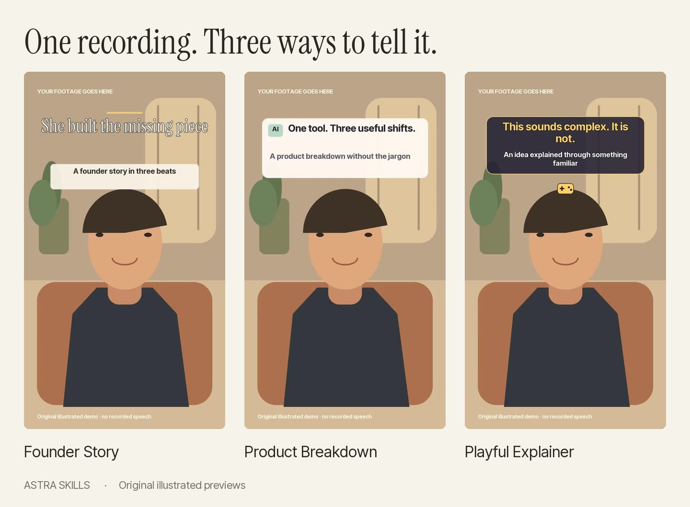

# Astra Skills

**Edit a talking-head reel in one prompt.** This is my GPT-6 Astra editing workflow, packaged as a skill your coding assistant can run, plus three ready-made reel templates with fill-in scripts and a local editor that does the rendering.



## The one prompt

Use this repository as a template (the green **Use this template** button, or [download the latest release](https://github.com/bhavya-gx/astra-skills/releases/latest)). Open the folder in Codex with GPT-6 Astra, or in Claude Code, and paste:

```text
Use the reel-edit skill in this repository to edit my talking-head clip.

Source: [MY VIDEO PATH]
Template: [founder-story / product-breakdown / playful-explainer]
Optional style reference: [REFERENCE PATH OR NONE]
```

The full version with the editorial rules is [prompts/first-edit.md](prompts/first-edit.md). The skill lives in `.agents/skills/reel-edit/SKILL.md` (Codex) and `.claude/skills/reel-edit/SKILL.md` (Claude Code). Both copies are identical. The assistant inspects your footage, transcribes it locally, cuts long pauses and false starts, places the cards on the phrases you actually said, grades the colour, renders a preview, and hands you the editable project. Revise with timestamps using [prompts/revisions.md](prompts/revisions.md).

Astra and Codex need your own access. The model is not included and is not open source. Everything else here is.

## Pale Yellow Reel skill

For a single lifestyle clip with a fixed title, use [pale-yellow-reel](.agents/skills/pale-yellow-reel/SKILL.md). It saves the approved four-second, 30 fps layout: pale-yellow lettering, fixed text placement and a lower, wider crop. It provides both 540×960 previews and 1080×1920 exports, with explicit source/output timing and validation.

```text
Use the pale-yellow-reel skill to edit my portrait clip.
Source: [MY VIDEO PATH]
Local template assets: [FOLDER WITH title.png AND audio.m4a]
```

The exact lettering and audio stay in your local asset folder; public copies contain the style settings and renderer. An installed personal skill can keep the assets beside its settings. The [composition diagram](assets/previews/pale-yellow-reel-layout.png) illustrates the layout without using personal footage. This skill has its own render command and does not change the editor's three talking-head templates.

## No AI account? Use the editor

1. Install [Python 3.12 or newer](https://www.python.org/downloads/) if you do not already have it.
2. Open **Start-Mac.command** on Mac, **Start-Windows.bat** on Windows, or run `sh start-linux.sh` on Linux. The first setup installs the tools inside this folder and needs internet access. Leave that window open.
3. The local editor opens in your browser. Click **Try an illustrated demo**, or add your own footage. Choose a style, edit the words, and click **Render preview**. Review it, then **Export 1080p**.

If the launcher does not open, run `python3 bootstrap.py` (Windows: `py bootstrap.py`) from a terminal in this folder. See [troubleshooting](docs/troubleshooting.md). Nothing is installed into your global Python. Speech recognition and optional background separation run on your computer and download a model on first use.

## Three templates, make them yours

| Template | Best for | Look | Fill-in script |
| --- | --- | --- | --- |
| **Founder Story** | Founder profiles, origin stories, lessons | Editorial serif, cream note cards, warm accents | [scripts/founder-story.md](scripts/founder-story.md) |
| **Product Breakdown** | Launches, tool reviews, feature explainers | Bold sans type, numbered white cards, muted green | [scripts/product-breakdown.md](scripts/product-breakdown.md) |
| **Playful Explainer** | AI concepts, analogies, approachable explainers | Bold amber type, original icons, subtle sound hooks | [scripts/playful-explainer.md](scripts/playful-explainer.md) |

Watch the [Founder](assets/previews/founder-story.mp4), [Product](assets/previews/product-breakdown.mp4), or [Explainer](assets/previews/playful-explainer.mp4) demos. They use an original illustration and no recorded speech, so you can try the whole renderer before adding your own footage. The example companies are fictional.

Each template is a JSON file in `templates/`. Copy one, change the hook, cards, ending, colours and positions, and it is your style. The [project format](docs/project-format.md) documents every field.

## What the renderer does on its own

- Conservative long-pause trimming, short audio joins, optional steady-noise reduction, and dialogue loudness normalisation.
- Captions from local speech recognition or your own source-timed SRT, remapped through the cuts.
- Editable hook, three cards, ending, accent, text positions, warm grade, per-clip tint correction, and synthesised transition sounds.
- Original framing kept intact, blurred canvas fill for non-vertical sources, optional portrait separation for background blur.
- A 540×960 draft or 1080×1920 H.264/AAC export, plus the edit decisions, project JSON, captions, and a validation report.

Default card timing splits the edit into five even sections. Phrase-specific timing comes from `stage_starts`, which the skill fills in from the transcript. The renderer does not decide which repeated phrases are intentional, promise exact reference matching, or fetch B-roll. Those are the assistant's editorial calls, with your review.

## How the workflow runs

The [walkthrough](docs/walkthrough.md) is the real review loop: inspect the source, transcribe, cut in source time, add graphics, match colour across clips, revise with timestamps, export, keep the project. Cuts are expressed in original source time and graphics in edited output time, so a revision never loses track of where a moment came from.

## Review with notes, not paragraphs

```sh
.venv/bin/python -m reelkit review my-preview/preview.mp4
```

The draft opens in your browser with a waveform and its captions. Click a moment or drag a range, type what is wrong, press Enter. Notes save next to the render as `preview.review.json`, with the words you were hearing. Paste the "Work through my review notes" prompt from [prompts/revisions.md](prompts/revisions.md) and the assistant fixes each note, writes a one-line reply under it and marks it done; the page refreshes by itself. `python -m reelkit review FOLDER` lists every render under a folder with its open-note count, and `--print` gives the notes as text. Nothing is uploaded.

## Pink B-roll Reel skill

Use [pink-broll-reel](.agents/skills/pink-broll-reel/SKILL.md) for the approved three-shot lifestyle montage: fixed pink lettering, reference audio and a 12.6-second ending. It provides 540×960 previews and 1080×1920 masters, explicit source/output timing and configurable crops. See the [layout diagram](assets/previews/pink-broll-reel-layout.png).

```text
Use the pink-broll-reel skill with these three portrait clips, in order.
Sources: [OPENING CLIP], [SECOND CLIP], [CLOSING CLIP]
Local assets: [FOLDER WITH title.png AND audio.m4a]
```

The public skill includes settings and a standalone renderer. Exact lettering, reference audio and personal footage stay local. It does not change the three talking-head templates below.

## For developers

```sh
python3 bootstrap.py --check
.venv/bin/python -m unittest discover -s tests -v
.venv/bin/python -m reelkit demo --template all
```

On Windows use `.venv\Scripts\python.exe`. `python3 bootstrap.py --lite` skips the speech and portrait dependencies. Code is in `reelkit/`, styles in `templates/`, renders go to `.local/` which Git ignores. Python 3.10+ required, 3.12+ recommended. SDR/Rec.709 input, English and Latin-script typography.

Version 0.1.0 is a tested starter, not a general timeline editor. [Test evidence](release/TEST-REPORT.md) · [Contributing](CONTRIBUTING.md) · [Security](SECURITY.md)

## License and credits

Original code, docs, icons, and demo artwork are MIT licensed. Inter Tight and Instrument Serif keep their SIL Open Font Licenses. Dependencies and downloaded models keep their own licenses, listed in [THIRD_PARTY_NOTICES.md](THIRD_PARTY_NOTICES.md). No personal footage, proprietary fonts, or other creators' reference videos are included.

This is an independent community workflow. GPT-6 Astra and Codex are OpenAI products; see [OpenAI's model documentation](https://learn.chatgpt.com/docs/models) for availability.
